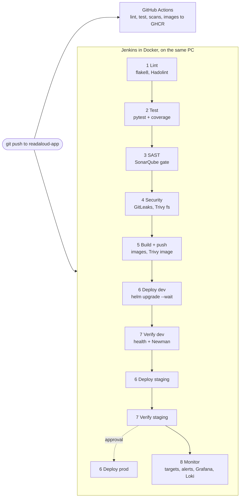

# ReadAloud architecture

ReadAloud turns a PDF or `.txt` into something you can listen to: the web app
reads the document sentence by sentence with a natural voice (Piper, on the
server), highlights where it is, and can summarize or answer questions about the
document (Gemini). This repo holds everything that builds, ships, runs and
watches it; the code is in `readaloud-app`.

## The running system

```mermaid
flowchart LR
  user([Browser]) -->|http://readaloud.local| ingress[NGINX Ingress]
  subgraph cluster [Minikube cluster "readaloud" (Terraform: platform)]
    ingress -->|/| web[web: Flutter app on nginx]
    ingress -->|/api| backend[backend: Flask + gunicorn + Piper voice]
    backend --> pg[(PostgreSQL 15<br/>StatefulSet + PV)]
    backend --> uploads[(uploads PV)]
    subgraph monitoring [namespace monitoring]
      prom[Prometheus] -->|scrapes /metrics| backend
      prom --> am[Alertmanager]
      am --> recv[alert-receiver<br/>logs every alert]
      graf[Grafana<br/>ReadAloud dashboard] --> prom
      graf --> loki[Loki]
      promtail[Promtail DaemonSet] -->|container logs| loki
    end
  end
  backend -->|Summary / Ask| gemini[(Gemini API)]
  am -.->|optional| slack([Slack / email])
```

The same chart runs three times, once per namespace: `dev`
(`readaloud.local`), `staging` (`staging.readaloud.local`) and optionally
`prod` (`prod.readaloud.local`). Grafana, Prometheus and Alertmanager have their
own hostnames (`grafana.readaloud.local`, ...).

## How a change reaches the cluster



Jenkins and SonarQube run in Docker Compose next to Minikube (not inside it):
Jenkins reaches the cluster over Minikube's Docker network and loads the images
it just built and scanned straight into the node, so the cluster runs exactly
the scanned bytes and no registry login is needed ([ADR 0002](adr/0002-images-loaded-into-minikube.md)).

## Infrastructure as code

```
terraform/
  state/          Postgres for remote state (docker compose), outside the cluster
  platform/       root: Minikube cluster + monitoring/logging stack  (one state)
  environments/   root: one workspace per environment -> namespace, quota, limits
  modules/
    minikube-cluster/   the cluster (driver, size, addons)
    monitoring/         kube-prometheus-stack, Loki, Promtail, dashboard, alert routing
    app-environment/    namespace + ResourceQuota + LimitRange
```

Terraform owns the platform and the environments; Helm (run by Jenkins) owns
the app releases inside them ([ADR 0004](adr/0004-terraform-platform-vs-helm-releases.md),
[ADR 0005](adr/0005-terraform-remote-state-and-workspaces.md)).

## Where each concern lives

| Concern | Where |
|---|---|
| App code, Dockerfiles, unit tests, GitHub Actions | `readaloud-app` |
| Pipeline | `Jenkinsfile`, `jenkins/`, `scripts/` |
| Kubernetes objects | `helm/readaloud` (Deployments, StatefulSet, Services, ConfigMap, Secret, Ingress, PVCs, ServiceMonitor, PrometheusRule) |
| Cluster, monitoring, environments | `terraform/` |
| API tests | `tests/api` (Newman) |
| Alert rule tests | `tests/alerts` (promtool) |
| How to run / fix it | `docs/DEPLOYMENT.md`, `docs/RUNBOOK.md` |

## Custom application metrics

The backend exposes `/metrics` (prometheus-flask-exporter, multiprocess mode so
both gunicorn workers are counted):

| Metric | Meaning |
|---|---|
| `flask_http_request_total`, `flask_http_request_duration_seconds` | requests by status and route, latency |
| `readaloud_tts_requests_total{status}`, `readaloud_tts_synthesis_seconds`, `readaloud_tts_characters_total` | the Piper voice: sentences spoken, time per sentence |
| `readaloud_llm_requests_total{kind,status}`, `readaloud_llm_latency_seconds` | Gemini Summary / Ask calls |
| `readaloud_documents_uploaded_total`, `readaloud_document_pages`, `readaloud_users_registered_total`, `readaloud_tts_chunks_served_total` | usage |
